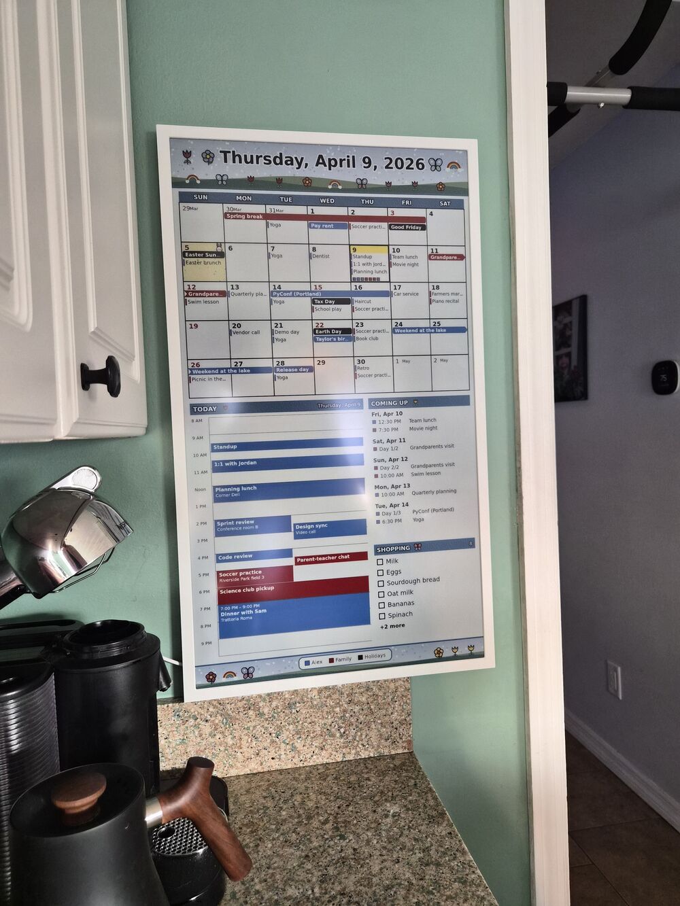
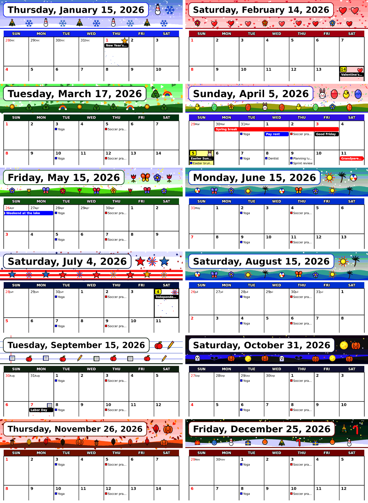
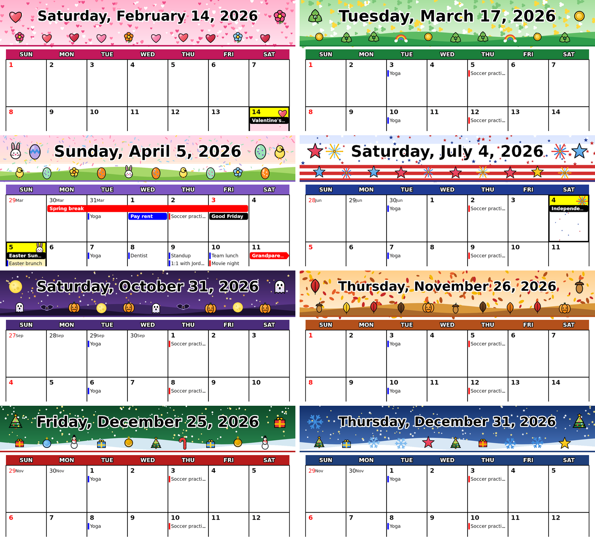

# samsung-epaper-calendar

<p align="center">
  <a href="docs/images/panel-photo.jpg"></a>
</p>

*The real panel, showing the Easter theme from the synthetic example calendars. Click for a larger view.*

A small server that draws a **family calendar** (month grid, today's agenda, shopping list) for a **Samsung EMDX color
e-paper display** and delivers it over Samsung's MDC protocol. It reads Google Calendar iCal links, themes each month, and
redraws the panel only when something changed. Home Assistant can decide *when* over MQTT.

<p>
  <a href="docs/images/paper-easter.png"></a>
  <a href="docs/images/timeline.png"></a>
</p>

*Both images are rendered from the synthetic calendars in `examples/` (`npm run demo`); they are the pictures the server sends. Click one for the full-size render.*

## What it does

- **Month grid** with multi-day events as one bar that wraps across weeks, timed events as titles with a thin bar in the calendar's color, per-calendar colors, red Sundays and holidays.
- **Today's agenda** with location, video link, guests and notes, plus **coming up** and a **shopping list** (JSON/text file or Google Tasks).
- **Two layouts** (`paper`, `timeline`) and a **theme for every month plus the holidays** (full color; Easter only around Easter, Halloween only the last week of October): [make your own](#themes) in the config file, with your own header and footer artwork if you like.
- **Sends only what changed.** The picture never depends on the time of day, so it changes when your calendar does or the date turns.
- **Wakes a sleeping panel** (Wake-on-LAN), waits until it has really fetched the picture, reads its battery, and can let it sleep again.
- **Home Assistant** over MQTT: a "redraw pending" sensor and a button, so an automation can redraw when the room is empty.

## Status

Unofficial, and built against **one EM32DX**. Samsung documents none of the panel protocol, so what is known comes from
community write-ups plus our own measurements, with each claim labeled in **[PROTOCOL.md](PROTOCOL.md)**. Honest headline:
the panel wakes and updates reliably over Wi-Fi, but **keeping it wakeable costs about 1.5 to 2 % of battery an hour**
(about two days a charge), so for a permanent install plan on USB-C or PoE+ power. Not yet exercised end to end on a real
panel: pushing from this project's server (the pieces were tested against a fake panel and, on real hardware, with the lab script).

## Quick start

With Docker (Intel/AMD or ARM, such as a Raspberry Pi or Home Assistant Yellow), using the published image:

```bash
cp .env.example .env                              # settings; .env is git-ignored
cp config/config.example.yaml config/config.yaml  # your calendars and themes; git-ignored
docker compose up -d                              # pulls ghcr.io/here-be-dragons/samsung-epaper-calendar (or builds it)
```

Or from source with Node 20 or newer:

```bash
npm install
npm test
node --env-file=.env src/server.mjs
```

Open `http://localhost:8080/` to see the latest frame, or `/preview?layout=timeline&theme=easter`. With no `DISPLAY_HOST` and
`DISPLAY_PIN` it only renders and serves. To drive a panel, set those two (and `PUBLIC_HOST`, the address the panel fetches
from), plus its Wi-Fi MAC as `DISPLAY_MAC` if it should be woken. To try it without any calendar of your own,
`npm run demo` renders the `examples/` calendars into `docs/images/`.

**Your Google Calendar secret iCal link is a password.** Keep it in `config/config.yaml` or `.env` (both git-ignored) and reset it in Google Calendar if it leaks.

## Configuring

Settings are environment variables (`.env`, see `.env.example`). The lists that grow and shrink, your calendars (any number),
displays and themes, live in `config/config.yaml`, which the compose file mounts at `/config`:

```yaml
calendars:
  - id: personal                     # optional: defaults to the name, lowercased
    name: Me                         # optional: defaults to the calendar's own name
    color: blue                      # red | green | blue | yellow | black (the panel's own inks)
    url: "${PERSONAL_ICAL_URL}"      # an https:// link, a local .ics path, or ${VAR} read from the environment
  - id: holidays
    name: US Holidays
    color: black
    mark_days: true                  # print its all-day dates in red on the grid
    url: "https://calendar.google.com/calendar/ical/en.usa%23holiday%40group.v.calendar.google.com/public/basic.ics"

displays:                            # optional; without it one display comes from DISPLAY_HOST, DISPLAY_PIN, DISPLAY_MAC in .env
  - id: kitchen
    host: 192.168.1.123
    pin: "${KITCHEN_PIN}"
    mac: "00:11:22:33:44:55"         # the panel's Wi-Fi MAC; with it set, waking is on
    layout: timeline                 # paper | timeline
```

### Themes

Each month wears its own design, and a holiday theme replaces it only around the holiday (Easter from the week before to the day
after, Halloween Oct 24 to 31, Christmas Dec 12 to 26 ...). You can change any of it, and define whole new themes, in the same file:

```yaml
themes:
  months:                        # which design each month wears: a theme name, or none (no theme at all that month)
    oct: october-night
  windows:                       # your holiday windows, every year; the first match wins, yours before the built-in ones
    - { from: easter-7, to: easter+1, theme: easter }   # MM-DD, or easter / thanksgiving with an offset in days
    - { from: 10-24, to: 10-31, theme: halloween }
  builtin_windows: true          # false: only your windows
  marks:                         # a decorated day cell on a date, every year, in any theme
    "05-14": { motif: star, tint: "#fff3c4", deco: ["#f5b700"] }
  custom:                        # your own themes
    october-night:
      extends: halloween         # start from a built-in theme (optional)
      chrome: "#3b2a5a"          # weekday band and panel titles (dark, as white text sits on it)
      sky: ["#1b1033", "#4a2d7a"]                       # banner and footer gradient, top to bottom
      pattern: { kind: stars, colors: ["#ffffff", "#ffd93d"], size: 6, density: 1200 }
      ground: { kind: hills, colors: ["#2a1a40", "#1c1030"], height: 0.3 }
      motifs: [pumpkin, ghost, bat, moon]               # the large pictures in the header
      holidays:
        "10-31": { motif: pumpkin, tint: "#ffe0b0", deco: ["#ff8a1f"] }
```

A custom theme changes the scenery's colors (bands, sky, pattern, ground, holiday tints) and chooses which motifs appear. The motifs
are drawn pictures with their own colors; to change one, or the whole banner and footer, draw your own PNGs
([themes/README.md](themes/README.md)). Your art is kept out of git, so it stays yours.

<p>
  <a href="docs/images/themes.png"></a>
  <a href="docs/images/holidays.png"></a>
</p>

## Documentation

| | |
|---|---|
| [docs/CONFIGURATION.md](docs/CONFIGURATION.md) | The config file, calendars, layouts, themes, shopping list, redraw modes, battery and waking settings, Home Assistant entities |
| [themes/README.md](themes/README.md) | Drawing your own header, footer and motif PNGs for the themes |
| [PROTOCOL.md](PROTOCOL.md) | What we know about the panel: MDC session and commands, manifest, waking, sleep, battery |
| [docs/PANEL-LAB.md](docs/PANEL-LAB.md) | `scripts/panel_lab.py`: test your own panel (wake, battery, push, drain) |
| [CLAUDE.md](CLAUDE.md) | Notes for contributors and AI assistants: design rules and code layout |

## Credits

The delivery convention and much of the panel knowledge come from [fayep/Joyous](https://github.com/fayep/Joyous) and
[lexdoudkin/frontpage](https://github.com/lexdoudkin/frontpage/blob/main/PROTOCOL.md). Fonts are DejaVu (free license, see
`fonts/README.md`). This project is not affiliated with or endorsed by Samsung.

## License

[MIT](LICENSE). The bundled DejaVu fonts keep their own license (`fonts/README.md`).
