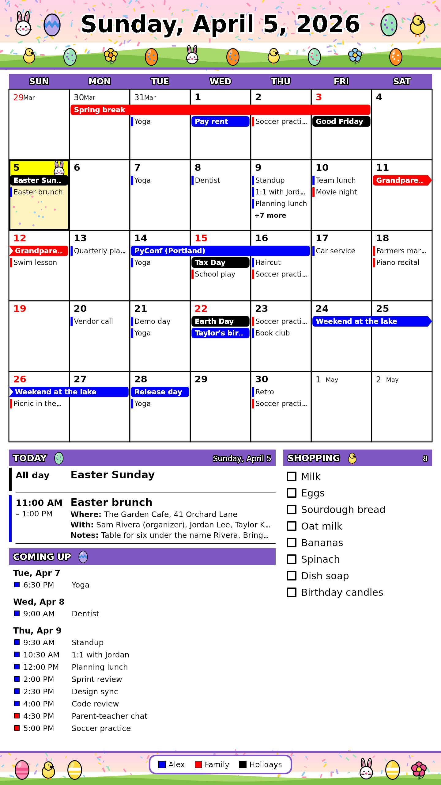
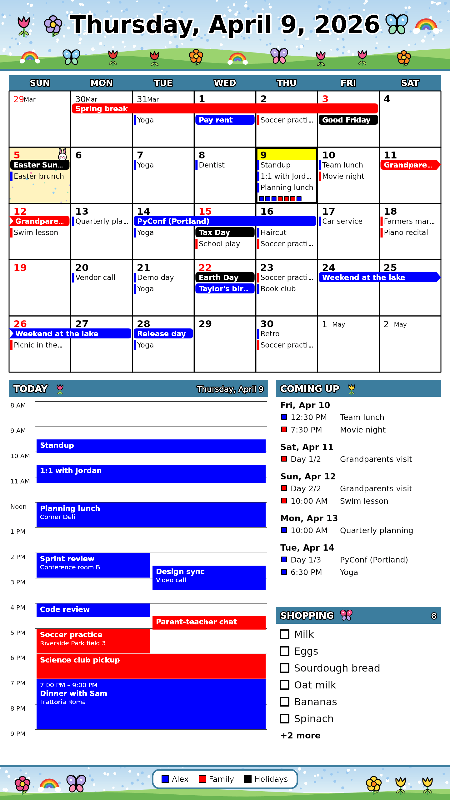

# samsung-epaper-calendar

A small server that draws a **family calendar** (month grid, today's agenda, shopping list) for a **Samsung EMDX color
e-paper display** and delivers it over Samsung's MDC protocol. It reads Google Calendar iCal links, themes each month, and
redraws the panel only when something changed. Home Assistant can decide *when* over MQTT.

<p>
  
  
</p>

*Both images are rendered from the synthetic calendars in `examples/` (`npm run demo`) and are exactly what the panel receives.*

## What it does

- **Month grid** with multi-day events as one bar that wraps across weeks, per-calendar colors, red Sundays and holidays.
- **Today's agenda** with location, video link, guests and notes, plus **coming up** and a **shopping list** (JSON/text file or Google Tasks).
- **Two layouts** (`paper`, `timeline`) and **twelve monthly themes** (Easter in April, and so on): full color, dithered to the panel's six inks.
- **Sends only what changed.** The picture never depends on the time of day, so it changes when your calendar does or the date turns.
- **Wakes a sleeping panel** (Wake-on-LAN), waits until it has really fetched the picture, reads its battery, and can let it sleep again.
- **Home Assistant** over MQTT: a "redraw pending" sensor and a button, so an automation can redraw when the room is empty.

## Status

Unofficial, and built against **one EM32DX**. Samsung documents none of the panel protocol, so what is known comes from
community write-ups plus our own measurements, with each claim labeled in **[PROTOCOL.md](PROTOCOL.md)**. Honest headline:
the panel wakes and updates reliably over Wi-Fi, but **keeping it wakeable costs about 1.5 to 2 % of battery an hour**
(about two days a charge), so for a permanent install plan on USB-C or PoE+ power. Not yet exercised end to end on a real
panel: pushing from this project's server (the pieces were tested against a fake panel and, on real hardware, with the lab script).

## Quick start

```bash
cp .env.example .env        # add your calendar links; .env is git-ignored
npm install
npm test
node --env-file=.env src/server.mjs      # or: docker compose up --build -d
```

Open `http://localhost:8080/` to see the latest frame, or `/preview?layout=timeline&theme=easter`. With no `DISPLAY_HOST` and
`DISPLAY_PIN` it only renders and serves. To drive a panel, set those two (and `PUBLIC_HOST`, the address the panel fetches
from), plus its Wi-Fi MAC as `DISPLAY_MAC` if it should be woken.

To try it without any calendar of your own, `npm run demo` renders the `examples/` calendars into `docs/images/`.

**Your Google Calendar secret iCal link is a password.** Keep it in `.env` (never committed) and reset it in Google Calendar if it leaks.

## Documentation

| | |
|---|---|
| [docs/CONFIGURATION.md](docs/CONFIGURATION.md) | Calendars, layouts, themes, shopping list, redraw modes, battery and waking settings, Home Assistant entities |
| [PROTOCOL.md](PROTOCOL.md) | What we know about the panel: MDC session and commands, manifest, waking, sleep, battery |
| [docs/PANEL-LAB.md](docs/PANEL-LAB.md) | `scripts/panel_lab.py`: test your own panel (wake, battery, push, drain) |
| [CLAUDE.md](CLAUDE.md) | Notes for contributors and AI assistants: design rules and code layout |

## Credits

The delivery convention and much of the panel knowledge come from [fayep/Joyous](https://github.com/fayep/Joyous) and
[lexdoudkin/frontpage](https://github.com/lexdoudkin/frontpage/blob/main/PROTOCOL.md). Fonts are DejaVu (free license, see
`fonts/README.md`). This project is not affiliated with or endorsed by Samsung.

## License

[MIT](LICENSE). The bundled DejaVu fonts keep their own license (`fonts/README.md`).
